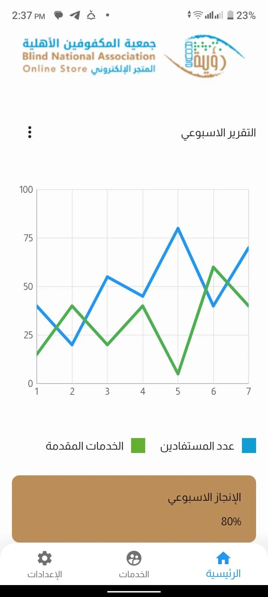
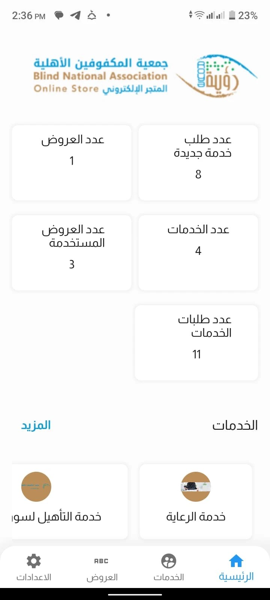
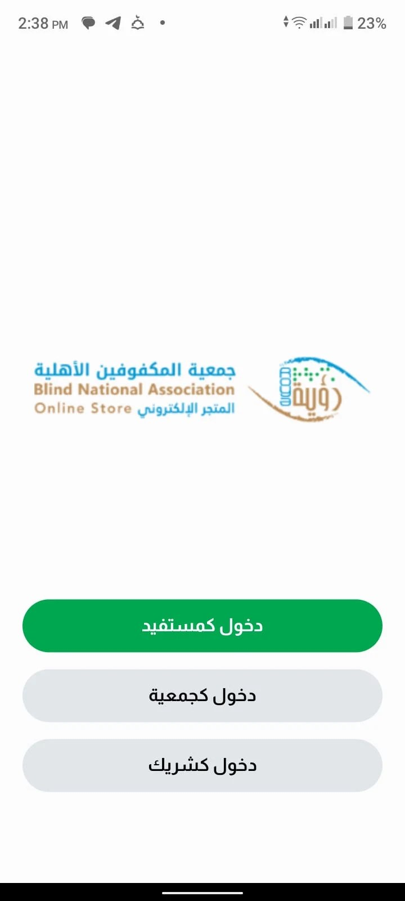
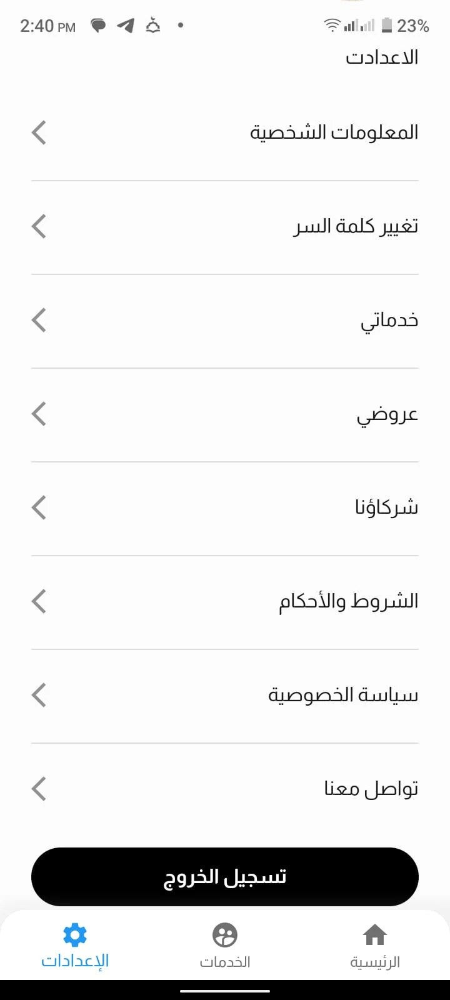

# Takamol Platform

**Charity and community services, connected securely.** Flutter app, live on the App Store & Google Play.

Takamol is an integrated digital platform that connects beneficiaries, volunteers, and partners to deliver services and support securely, with a dedicated dashboard for each account type, real-time request tracking, and direct communication between all parties.

## Download

- [Google Play](https://play.google.com/store/apps/details?id=com.smartvision.tkamol_platform)
- [App Store](https://apps.apple.com/us/app/%D8%AC%D9%85%D8%B9%D9%8A%D8%A9-%D8%AA%D9%83%D8%A7%D9%85%D9%84/id6480185206)

## Built with

Flutter · Bloc state management · RESTful API · Hive · Firebase

## Screenshots

   

---

*Production source code is proprietary; this repository is a public showcase of the released app.*
